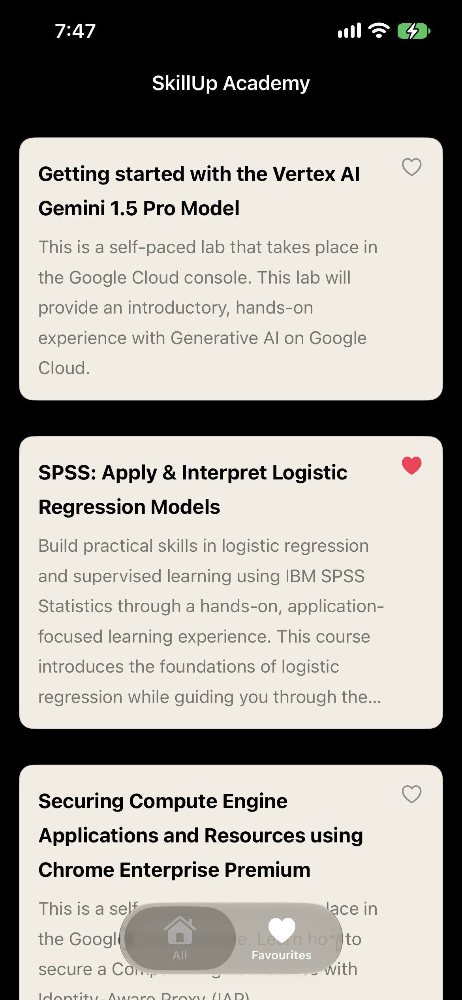
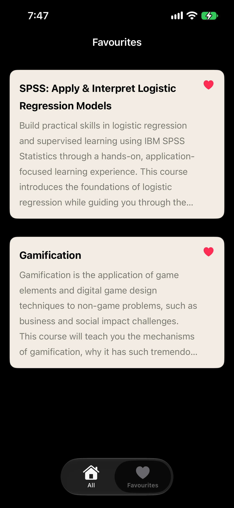

# SkillUpAcademy

A native SwiftUI app for browsing courses, managing favorites, and accessing course data offline.

## Demo Video
[Click here to watch the demo video](Video%20Demostration/demo.mp4)

## Screenshots
| Home (Courses) | Favorites |
|------|-----------|
|  |  |

*(Note: The offline banner appears automatically above the list when the device loses internet connection).*

---

## Architecture
The app is built using the **MVVM** (Model-View-ViewModel) architecture to ensure a clean separation of concerns and maintainable code.
- **Models:** `Course` defines the data structure.
- **Services:** Contains `defaultCourseFetcher` (handles networking with `URLSession` and `async/await`) and `CourseCache` (handles local JSON persistence).
- **ViewModels:** `CoursesViewModel` manages the state machine (`idle → loading → loaded → error`) and caching logic. `FavouritesViewModel` manages the favorites list.
- **Views:** SwiftUI views including `CoursesListView`, `coursesCardView`, `FavouritesScreen`, and a `TabView` for navigation.

### How Favorites are Stored
Favorites are persisted locally using `UserDefaults` via the `DefaultFavouritStorage` service. This ensures that a user's favorited courses survive app restarts. The `FavouritesViewModel` tracks the favorited course IDs and updates the UI reactively.

---

## How to Run

### Option 1: Run the Pre-built Simulator App (Fastest)
1. Download `internship_proj-1-Simulator.zip` from this repository.
2. Unzip the file to reveal `internship_proj-1.app`.
3. Open the iOS Simulator on your Mac.
4. Drag and drop the `.app` file directly onto the Simulator screen to install and launch it.

### Option 2: Build and Run from Source
1. Clone this repository.
2. Open `internship_proj-1.xcodeproj` in Xcode.
3. Select an iPhone Simulator (e.g., iPhone 15) from the destination menu.
4. Press `Cmd + R` to build and run.

---

## Development Milestones (Tasks 1-5)

**Task 1: Initial Setup & UI**
- Created a `Course` model to store information about each course.
- Added sample courses inside the view model to display in the app.
- Organized the code into MVVM.
- Created a reusable `coursesCardView` component and utilized it to list different courses in `CoursesListView`.

**Task 2: Networking & State Management**
- Replaced sample data with a real API call.
- Wrote a `defaultCourseFetcher` service using URLSession and async/await, decoding JSON into `Course` objects.
- Added a typed `APIError` enum for clear network and decoding failure messages.
- Gave `CoursesViewModel` a state machine (idle → loading → loaded → error) and made the view react to each one (spinner, list, error screen with Retry).

**Task 3: Favorites System**
- Added a `FavouritesViewModel` to track favorited course IDs.
- Persisted favorites locally using `UserDefaults`.
- Built a reusable `FavoriteButton` and added it to `coursesCardView`.
- Made a `FavouritesScreen` that filters courses down to only the favorited ones.
- Wrapped everything in a `TabView` with Courses and Favorites tabs.

**Task 4: Offline Caching**
- Added a `CourseCache` service to save and load courses locally as JSON in the Documents directory.
- If the network fails on launch, the view model loads the cached file instead of showing an error.
- Added an `isShowingCachedData` flag to trigger a gray banner above the list saying "Offline mode – showing cached courses".
- The banner disappears on a successful retry and the cache file is overwritten with fresh data.

**Task 5: Final Handover**
- Archived the project in Xcode for release.
- Generated a Simulator-runnable `.app` bundle and compressed it for download.
- Wrote this comprehensive README.
- Captured screenshots of the Home and Favorites screens.
- Recorded a demo video showcasing the main flows.
- Published everything to this public GitHub repository.
